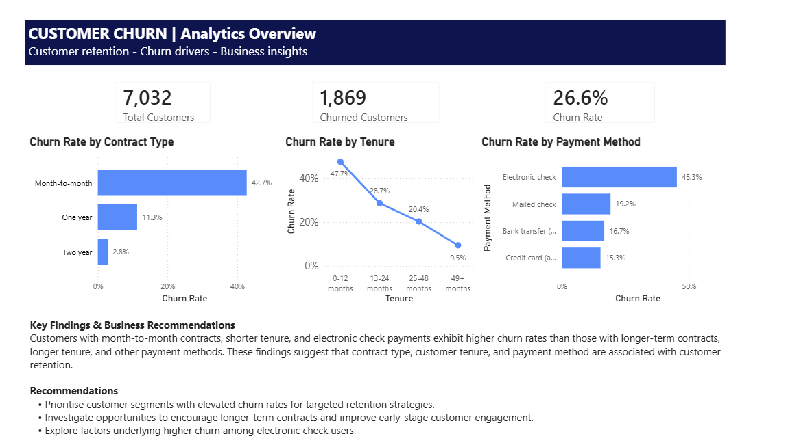

# Customer Churn Prediction and Retention Insights

## Project Overview
This project analyses customer churn using Python, SQL, machine learning and Power BI.

## Business Problem
The aim is to identify customers at high risk of churn and provide retention recommendations.

## Tools Used
- Python
- SQL
- Power BI
- scikit-learn
- pandas

## Key Findings
- Month-to-month customers had the highest churn rate.
- Customers with higher monthly charges were more likely to churn.
- Short-tenure customers showed higher churn risk.

## Machine Learning
Models used:
- Logistic Regression
- Random Forest

## Power BI Dashboard

The updated Power BI dashboard presents customer churn KPIs and churn-rate comparisons across contract types, customer tenure and payment methods. It also summarises key findings and potential retention strategies.

The original exploratory dashboard is retained in the powerbi/archive/ folder for reference.

## Recommendations
- Encourage month-to-month customers to move to longer-term contracts.
- Improve onboarding for new customers.
- Review pricing/value perception for high-charge customers.
